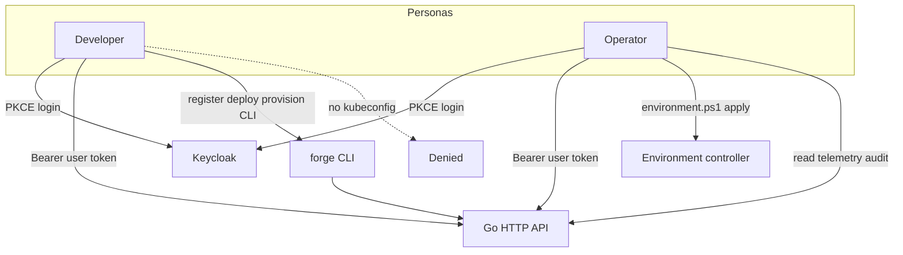
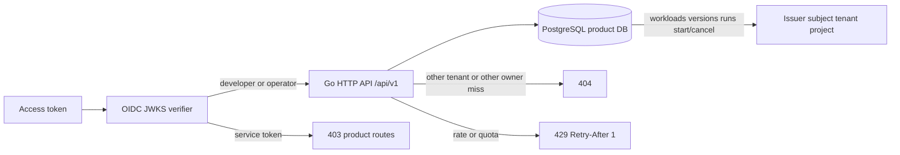
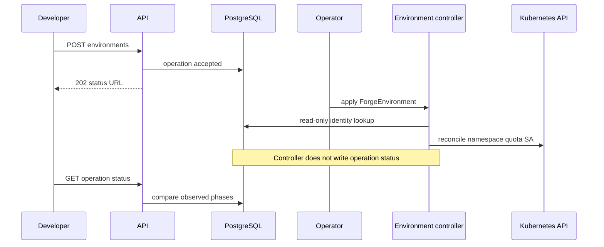
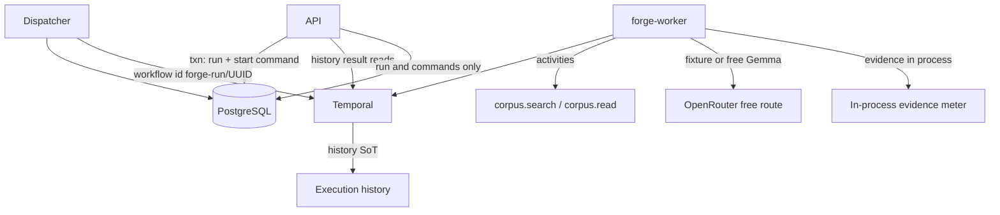
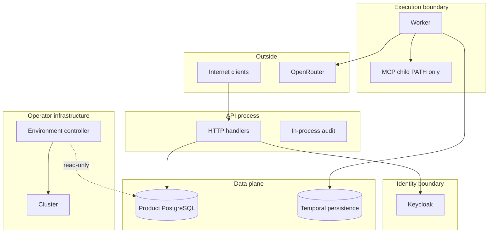
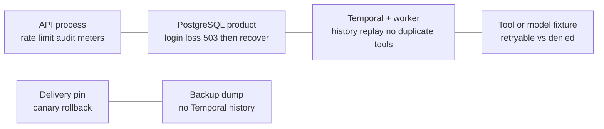
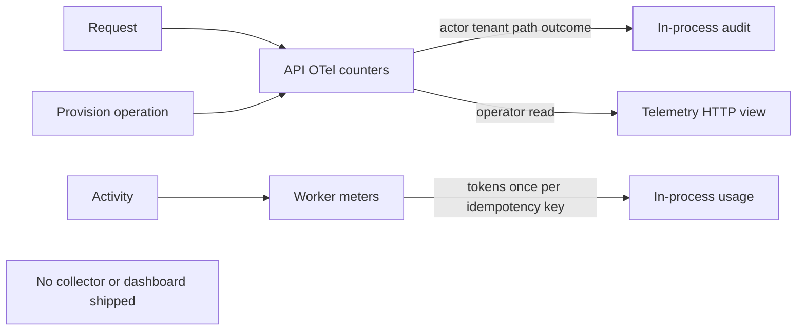

# Architecture diagrams — F52

[D67](../decision-log.md#d67--f52-architecture-diagrams-and-adr-index) records the boundary. These diagrams describe the **implemented demo composition**. They do not close G3–G6 or claim a live cloud deployment.

Companion: [ADR index](../adr/README.md) · [architecture narrative](../architecture.md) · [threat model](../threat-model.md)

## 1. Personas and primary paths

## 2. Identity, API, and product store

## 3. Provisioning and controller

## 4. Asynchronous execution data flow

## 5. Trust boundaries

## 6. Failure domains

Measured samples (not SLOs): F47 worker_loss 38118 µs / 0 side effects; tool_model_outage 30695 µs / 1 evidence; database_outage 17329 µs; quota_exhaustion 16572 µs; bad_rollout 33 µs; F46 dump 61.76 ms / restore 71.79 ms; F45 rollback call 54.4 µs.

## 7. Telemetry

